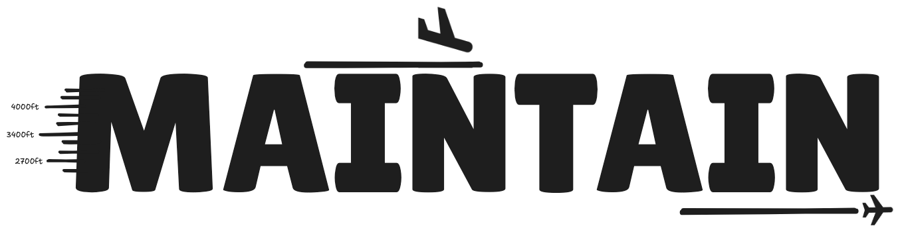
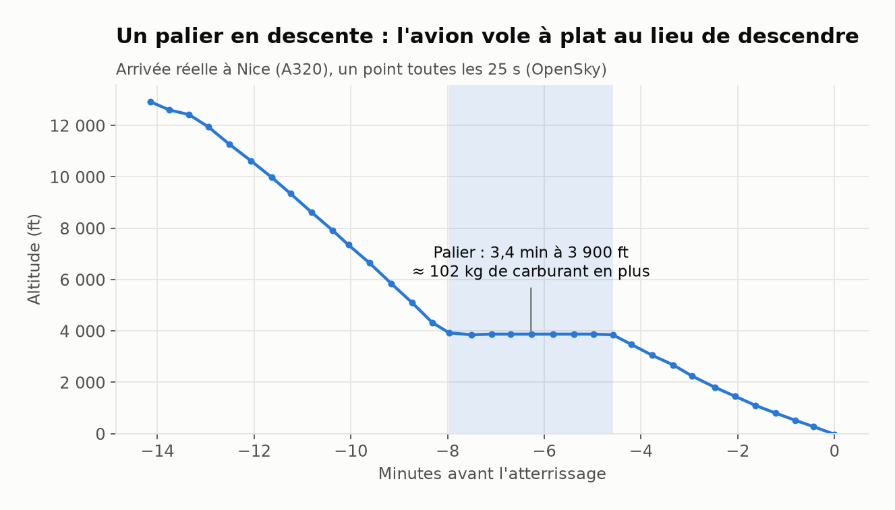
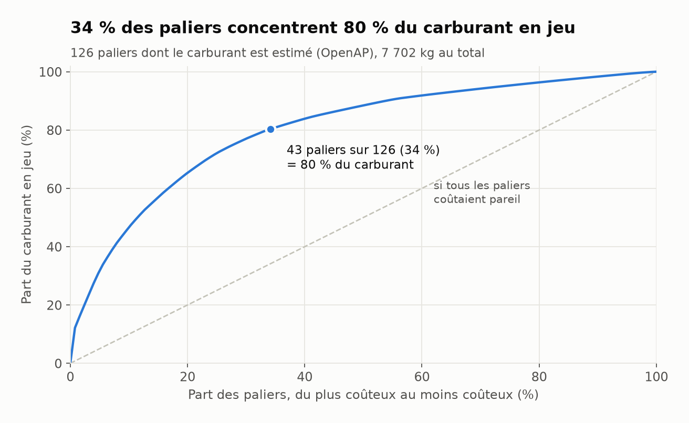
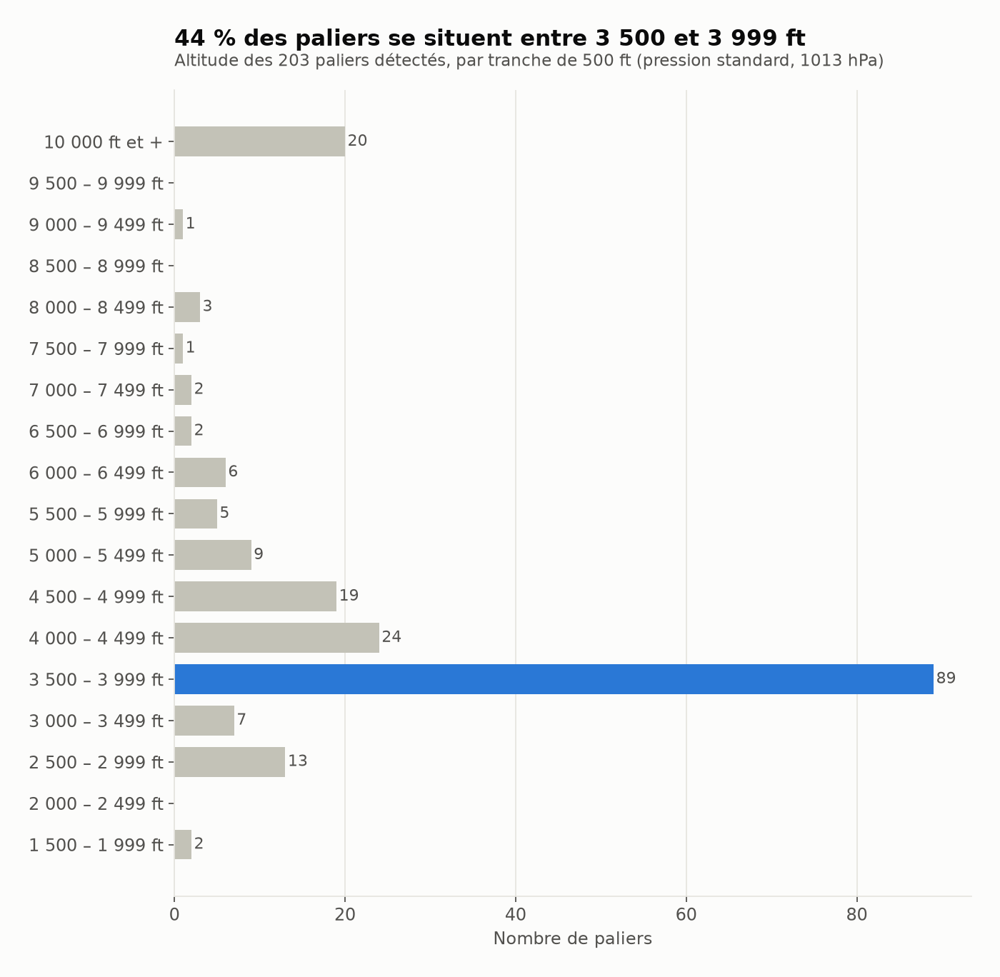
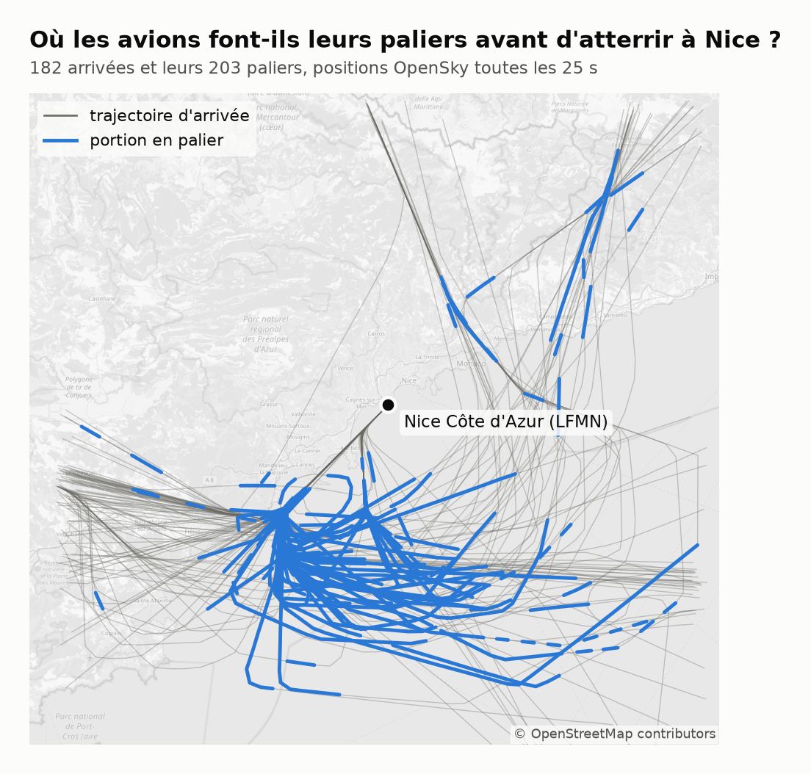

<p align="center">
  <picture>
    <source media="(prefers-color-scheme: dark)" srcset="docs/img/logo_maintain_dark.png">
    
  </picture>
</p>

# MAINTAIN : les paliers en descente vers Nice Côte d'Azur (LFMN)

> *« Descend and maintain 4000 feet »* : chaque palier imposé en descente se paie en carburant.

**Combien de carburant et de CO₂ coûtent les paliers pendant la descente vers Nice ?**

Une descente continue (CDO) se fait presque moteurs au ralenti. Un avion qui vole en palier pendant sa descente doit au contraire remettre de la poussée : chaque palier a donc un coût en carburant. À partir de données ADS-B publiques (OpenSky Network), ce projet reconstruit les arrivées à Nice, détecte leurs paliers et estime le carburant et le CO₂ en jeu.

> **Pourquoi Nice ?** J'ai travaillé aux opérations piste de l'aéroport Nice Côte d'Azur. J'ai vu ces pratiques depuis le tarmac, et je les mesure ici dans la donnée.

## Résultats

*Chiffres définitifs à compléter (collecte en cours).*

<p align="center"></p>

<p align="center"></p>

<p align="center"></p>

<p align="center"></p>

---

## Architecture

```
API OpenSky ──► collecte (25 s) ──► découpage en vols ──► paliers + carburant ──► BigQuery ──► dbt ──► Power BI
               opensky_live_         00_split_flights     02_build_tables  │     03_load_     staging
               collector                                                 │     bigquery     → marts
                                                                         └──► 04_figures (graphiques et carte du README)
```

| Étape | Outil | Sortie |
|---|---|---|
| Collecte | API REST OpenSky (`scripts/opensky_live_collector.py`) | positions de tous les avions autour de Nice, un fichier par heure |
| Découpage | pandas (`src/eco_nice/split.py`) | arrivées et départs de Nice, un fichier par jour |
| Paliers | pandas (`src/eco_nice/features.py`) | un palier = début, fin, altitude, durée |
| Carburant | OpenAP (`src/eco_nice/fuel.py`) | kg de carburant et de CO₂ estimés par palier |
| Modélisation | dbt + BigQuery | `fct_arrivals_efficiency` : une ligne par arrivée |
| Restitution | Power BI | taux de descente continue, CO₂ évitable par heure et par type d'avion |

## Méthode

**Palier de descente** : entre le sommet de descente et 1 500 ft, toute période où l'avion descend de moins de 300 ft/min pendant au moins 20 s. La méthode est inspirée de celle d'EUROCONTROL pour mesurer les CDO. Un vol sans aucun palier est classé en descente continue.

**Données espacées** : la collecte donne un point toutes les 25 s. La pente est donc calculée entre deux points consécutifs (différence d'altitude / temps écoulé), plutôt qu'à partir de la vitesse verticale instantanée transmise par l'avion. Cette dernière sous-estimait la durée des paliers : je l'ai repéré en traçant des vols réels.

**Surcoût d'un palier** = (débit carburant en palier − débit en descente au ralenti) × durée. Les débits viennent du modèle OpenAP, au même point de vol.

Tous les paramètres sont dans [`src/eco_nice/config.py`](src/eco_nice/config.py).

## Limites (assumées)

- **Estimations, pas des mesures.** Sans les données de l'enregistreur de vol, la consommation vient d'un modèle de performance (OpenAP). La masse est supposée (90 % de la masse maximale à l'atterrissage), et la vitesse sol sert d'approximation de la vitesse air (le vent est ignoré).
- **Types d'avions.** Le type est inconnu pour une partie des vols, et quelques types non modélisés par OpenAP sont approchés par un modèle proche (colonne `fuel_type_proxy`). Les totaux de carburant sont donc des minimums.
- **Altitudes ADS-B.** Elles sont mesurées par rapport à la pression standard (1013 hPa), pas au QNH du jour : un écart de quelques dizaines à quelques centaines de pieds est possible avec les altitudes des cartes d'approche.
- **Contraintes de procédure et d'ATC.** Certains paliers sont imposés par la procédure d'approche ou par le contrôle aérien (séparations, relief autour de Nice). Le projet mesure un *potentiel*, il ne juge pas les équipages.

## Lancer le projet

```bash
python3 -m venv .venv && source .venv/bin/activate
pip install -r requirements.txt
pytest                                   # tests sur trajectoires simulées, sans réseau

export OPENSKY_CLIENT_ID="…" OPENSKY_CLIENT_SECRET="…"
python scripts/opensky_live_collector.py           # collecte en continu (Ctrl+C pour arrêter)

python scripts/00_split_flights.py --src data/opensky_live
python scripts/02_build_tables.py
python scripts/03_load_bigquery.py --project MON_PROJET_GCP
python scripts/04_figures.py                       # régénère les graphiques du README
python scripts/05_dispersion.py                    # dispersion des arrivées à 10/20/40/60 km

cd dbt && cp profiles.example.yml ~/.dbt/profiles.yml   # puis renseigner le projet GCP
dbt build
```

## Structure

```
├── src/eco_nice/        config · split (vols) · features (paliers, piste) · fuel (OpenAP)
├── scripts/             collecte · 00 découpage · 02 tables d'analyse · 03 chargement BigQuery · 04 graphiques
├── dbt/models/          staging (vues + tests) · marts (table pour Power BI)
├── tests/               trajectoires synthétiques avec réponses connues
├── docs/img/            logo et visuels du README
├── docs/code_commente/  copie de chaque script, commentée ligne par ligne en français
└── data/                données collectées et produites (ignorées par git)
```

## Suite du projet

- **Données à la seconde** : un récepteur ADS-B personnel (Raspberry Pi) près de Nice, et l'accès à la base historique OpenSky, pour mesurer aussi les paliers courts.
- **Roulage au sol** : temps de roulage et potentiel du roulage sur un moteur, dès que la couverture au sol sera suffisante (2 % des vols exploitables avec la collecte actuelle).
- **Paliers de procédure ou non** : distinguer les paliers imposés par la procédure d'approche des autres, en croisant avec les cartes d'approche du SIA.
- **Modélisation** : prédire le temps passé en palier (heure, type d'avion, trafic) avec un modèle expliqué (XGBoost + SHAP).

## Comment ce projet a été réalisé

Conception, choix des indicateurs, collecte des données, validation des résultats et analyse : Valentin Rouquier. Le code a été développé avec l'assistance d'une IA (Claude), puis relu, testé et documenté ligne par ligne ([`docs/code_commente/`](docs/code_commente/)).
